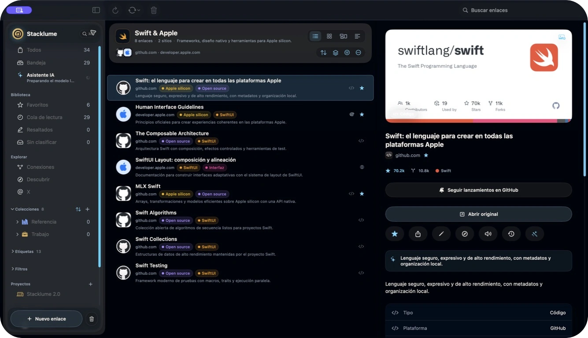
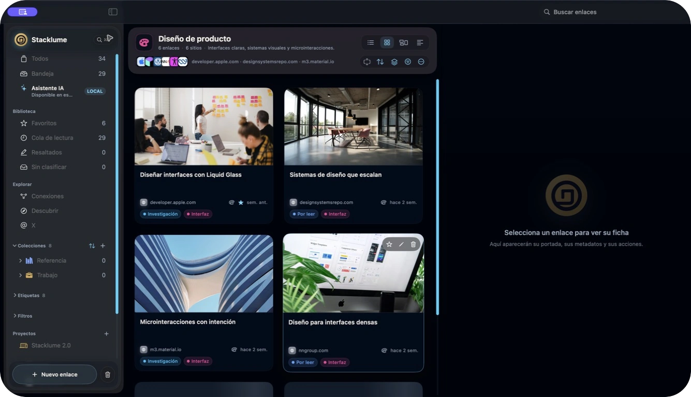

<p align="center">
  
</p>

# Stacklume para Mac

Tu biblioteca de enlaces, documentos y referencias en una app nativa de macOS. Organiza por colecciones y etiquetas, recupera contenido por significado y consulta tus fuentes con IA local.

**Gratis para siempre. Código abierto con licencia MIT.** La aplicación para Mac no requiere una cuenta, una suscripción ni una clave de licencia.

[Descargar para Mac](https://stacklume.app/mac/descargar) · [Releases de GitHub](https://github.com/SwonDev/Stacklume-Mac/releases) · [Contribuir](CONTRIBUTING.md) · [Privacidad](docs/privacy.md)



*Captura de la interfaz real con una biblioteca de demostración. Los enlaces y contadores pertenecen a ese entorno, no a una biblioteca personal.*

## Guarda, encuentra y vuelve a leer

| Cuando quieres… | Stacklume ofrece… |
|---|---|
| Capturar una referencia | Guardado rápido, barra de menús, Servicio de macOS, extensión para compartir y arrastrar y soltar. |
| Organizar una biblioteca | Colecciones anidadas, etiquetas, favoritos, bandeja, filtros y acciones en lote. |
| Elegir cómo consultar tus enlaces | Lista, Cuadrícula, Moodboard y Titulares, con una ficha para el enlace seleccionado. |
| Retomar una lectura | Cola de lectura, notas, resaltados, recordatorios y progreso de lectura. |
| Consultar archivos locales | Lectores de PDF y EPUB, imágenes y reconocimiento de texto en el Mac. |
| Recuperar una referencia por su contenido | Búsqueda semántica multimodal con EmbeddingGemma 2 y un explorador de conexiones. |
| Investigar un tema | Asistente local, fuentes guardadas y búsqueda web opcional, además de catálogos de Hugging Face y Civitai. |
| Conservar tus datos | Importación de marcadores, exportación y copias de seguridad locales. |

<details>
<summary>Ver la biblioteca en Cuadrícula</summary>



*La misma biblioteca de demostración, consultada por sus portadas.*

</details>

## Instalar

Necesitas un Mac con Apple silicon y macOS 26 o posterior.

1. Descarga el archivo de la release desde la [página de descarga](https://stacklume.app/mac/descargar) o sus [assets en GitHub](https://github.com/SwonDev/Stacklume-Mac/releases).
2. Descomprime el archivo y mueve `Stacklume.app` a Aplicaciones.
3. Abre Stacklume. Puedes empezar a guardar enlaces antes de cargar un modelo de IA.

La distribución utiliza firma ad hoc y no está notarizada por Apple. macOS puede bloquear la primera apertura al no reconocer a un desarrollador verificado. Tras comprobar que descargaste la release oficial y su suma SHA-256, puedes autorizar esa aplicación desde Ajustes del Sistema → Privacidad y seguridad → «Abrir igualmente». No desactives Gatekeeper de forma global. Si la suma no coincide, vuelve a descargar el archivo y comunica el problema.

## IA en tu Mac

El modelo local recomendado es **MiMo V2.6 Distill 9B**, multimodal a 4 bits mediante MLX. Puedes adjuntar imágenes al chat y elegir MiMo, Ornith 1.5 9B o LFM2.5 en Ajustes → IA. El mismo modelo local se utiliza en el chat, los borradores para X y el enriquecimiento; este último también permite elegir Apple Foundation Models cuando esté disponible. Una selección explícita se conserva al actualizar. El razonamiento permanece activado en las tareas del modelo local, con espacio reservado para la respuesta; el proceso interno no se guarda en el historial.

| Modelo local | Descarga aproximada | Entradas |
|---|---:|---|
| MiMo V2.6 Distill 9B · recomendado | 5,95 GB | Texto e imágenes |
| Ornith 1.5 9B | 6,51 GB | Texto e imágenes |
| LFM2.5-8B-A1B | 9 GB | Texto |

Los modelos visuales requieren un Mac de al menos 16 GB. Stacklume limita su contexto a 8k tokens en esa clase de memoria y adapta la carga a la presión del sistema. La comparación nativa se realizó en un Mac de 24 GB; el consumo depende del contexto y de las imágenes, además de los pesos.

La búsqueda utiliza `google/embeddinggemma-2`, con pesos `mlx-community/embeddinggemma-2-bf16` y revisión fijada. Stacklume incluye su runtime: para usar la app no necesitas instalar Python ni un servidor de embeddings. Los pesos de los modelos se descargan cuando hacen falta y su carga depende de la memoria disponible.

La búsqueda web del asistente está activada por defecto y puede desactivarse en los ajustes de IA. Las consultas web salen del Mac; la inferencia y el índice de tu biblioteca se procesan localmente. [Consulta las conexiones y controles de privacidad](docs/privacy.md).

## Compilar desde el código

El repositorio incluye los cinco paquetes propios en `Packages/` y la adaptación de MLX LM en `Vendor/`. No necesita otro checkout de Stacklume.

Requisitos de desarrollo: Xcode 27 con sus herramientas de línea de comandos, XcodeGen y `uv`. El lenguaje del proyecto está fijado en `project.yml`; las dependencias Swift están bloqueadas en `Config/Package.resolved` y las de Python en `Runtime/EmbeddingGemma/uv.lock`.

```bash
git clone https://github.com/SwonDev/Stacklume-Mac.git
cd Stacklume-Mac
brew install xcodegen uv
./scripts/bootstrap-project.sh
xcodebuild -project Stacklume.xcodeproj -scheme Stacklume \
  -configuration Debug -skipMacroValidation build
```

El bootstrap genera el proyecto Xcode y empaqueta el runtime local si falta. La primera preparación necesita conexión para obtener herramientas y dependencias; no descarga tu biblioteca ni tus conversaciones.

Para ejecutar las pruebas de lógica:

```bash
xcodebuild -project Stacklume.xcodeproj -scheme Stacklume \
  -destination 'platform=macOS' test
```

`project.yml` es la fuente de verdad: regenera el proyecto después de añadir, quitar o renombrar archivos Swift. [La guía de contribución](CONTRIBUTING.md) explica la estructura, la verificación y cómo proteger tus datos durante el desarrollo.

## Código y documentación

[Arquitectura](docs/architecture.md) · [Contrato visual](DESIGN.md) · [Privacidad](docs/privacy.md) · [Dependencias y avisos](NOTICE.md)

El código propio de Stacklume se distribuye bajo [MIT](LICENSE). Las dependencias y los pesos de los modelos conservan sus licencias y condiciones de origen; MIT no las reemplaza.
