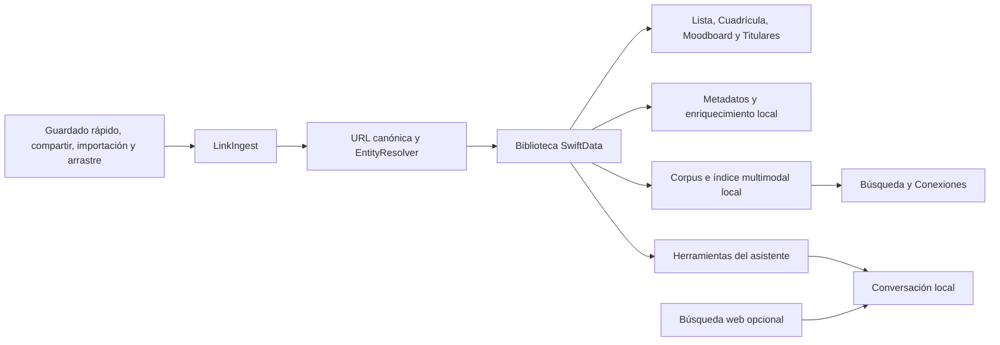

# Arquitectura de Stacklume para Mac

Stacklume es una aplicación nativa de macOS con SwiftUI, AppKit y SwiftData. La biblioteca es el centro del producto; la captura, la búsqueda y el asistente trabajan sobre esa misma información.

## Mapa del repositorio

| Ruta | Responsabilidad |
|---|---|
| `App/App/` | Entrada, escenas, ciclo de vida y composición de servicios. |
| `App/Features/` | Biblioteca, asistente, catálogos, ajustes y herramientas de usuario. |
| `App/Shared/` | Captura, almacenamiento lateral, búsqueda, copias y fronteras de red. |
| `Packages/` | Dominio, diseño, persistencia, metadatos e infraestructura de IA propios. |
| `Vendor/mlx-swift-lm/` | Adaptación local de MLX LM que conserva sus avisos de origen. |
| `Runtime/EmbeddingGemma/` | Motor multimodal local y dependencias Python fijadas. |
| `scripts/embeddinggemma/` | Empaquetado y comprobaciones del runtime portable. |
| `StacklumeTests/` | Pruebas de lógica sin host de aplicación. |
| `StacklumeWidget/` y `ShareExtension/` | Integraciones de macOS. |
| `project.yml` y `Config/Package.resolved` | Proyecto generado y revisiones Swift bloqueadas. |

## Una biblioteca, varios puntos de entrada

`LinkIngest` centraliza las altas, normaliza URL y evita duplicados. `EntityResolver` reutiliza colecciones y etiquetas. Las reglas deterministas por dominio preceden a las sugerencias de IA. El enriquecimiento protege las ediciones manuales y se coordina con la actividad del usuario.

El modelo central es `Bookmark`, acompañado de colecciones, etiquetas, resaltados y ajustes. Las funciones específicas de Mac que no necesitan una migración del modelo usan stores laterales por UUID o URL canónica, como progreso de lectura, notas de resaltados y portadas personalizadas.

## Ventanas y navegación

`StacklumeApp` prepara la persistencia y las escenas. `RootWindowView` usa `NavTarget` para elegir una sección y compone la navegación, el contenido y el detalle. La biblioteca ofrece selección múltiple y muestra el detalle de una sola selección. Catálogos y asistente aprovechan el espacio central ampliado.

La barra de menús utiliza `NSStatusItem`. Cerrar la última ventana deja disponibles las funciones de la barra; terminar la aplicación es una acción distinta. La persistencia se realiza durante el uso. El cierre conserva una salida explícita que evita el fallo del destructor de MLX/Metal.

SwiftUI compone las vistas y AppKit resuelve superficies donde se necesita control nativo sobre desplazamiento, selección, texto o imágenes. [DESIGN.md](../DESIGN.md) define los tokens y las reglas visuales.

## IA y búsqueda

| Componente | Función |
|---|---|
| `LocalAIRunner` | Carga y ejecución de `LiquidAI/LFM2.5-8B-A1B-MLX-8bit` con MLX. |
| `UnifiedAIService` | Enriquecimiento con el motor elegido: Liquid o Apple Foundation Models. |
| `LiquidConversation` | Sesiones, continuidad, generación, cancelación y coordinación de herramientas. |
| `LibraryAgentTools` | Operaciones sobre la biblioteca y lectura de fuentes. |
| `AssistantActionPolicy` | Selección de capacidades y política de acciones. |
| `AssistantConversationStore` | Historial local acotado, con escritura privada y recuperación. |
| `EmbeddingGemmaRuntime` | Proceso privado y runtime portable de la búsqueda multimodal. |
| `MultimodalSearchService` | Consulta del índice y conexión con los resultados de la biblioteca. |

EmbeddingGemma 2 se distribuye como código de runtime y manifiesto; sus pesos BF16 se obtienen del repositorio fijado `mlx-community/embeddinggemma-2-bf16`, revisión `1a4ffddb7905d3f63486748deabe091a01fb6201`. Produce vectores de 768 dimensiones. El proceso pertenece a Stacklume, usa un endpoint de loopback privado y no depende del servidor de embeddings de otras herramientas del equipo.

El LLM, el índice y las lecturas de red tienen responsabilidades separadas. La web es una fuente adicional revocable; no convierte la inferencia en un servicio remoto. Las respuestas deben distinguir metadatos guardados, resultados de búsqueda y páginas leídas.

## Persistencia y recuperación

SwiftData guarda la biblioteca. Los stores laterales completan los datos específicos de Mac y `CompleteBackupService` incorpora esos extras a las exportaciones compatibles. `AutoBackup`, `DailyBackup` y `BackupRecovery` cubren copias y recuperación local.

Una copia de la biblioteca puede contener notas, documentos y otros datos privados. El historial del asistente tiene su propio store; una exportación de biblioteca no debe interpretarse como una exportación de todas las preferencias, credenciales y conversaciones de la aplicación. [La guía de privacidad](privacy.md) explica estas diferencias.

## Compilación y verificación

XcodeGen genera el proyecto desde `project.yml`. El bootstrap fija la resolución SPM y prepara el runtime de búsqueda con `uv.lock`. Las builds de desarrollo y la distribución pública tienen necesidades de firma distintas: la publicación necesita verificar el artefacto firmado, sus extensiones, runtime y mecanismo de actualización.

Las pruebas de `StacklumeTests` compilan lógica autocontenida dentro de un bundle sin host. Las pruebas nativas de interacción, la inferencia real, las descargas y la validación de una release complementan ese conjunto; sus resultados no son intercambiables.
